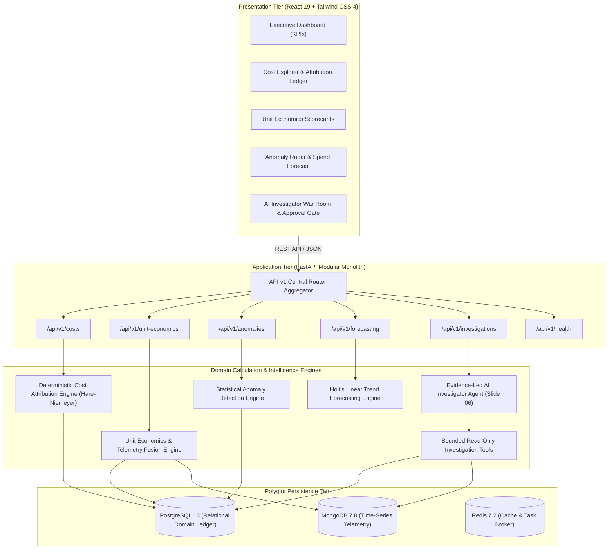
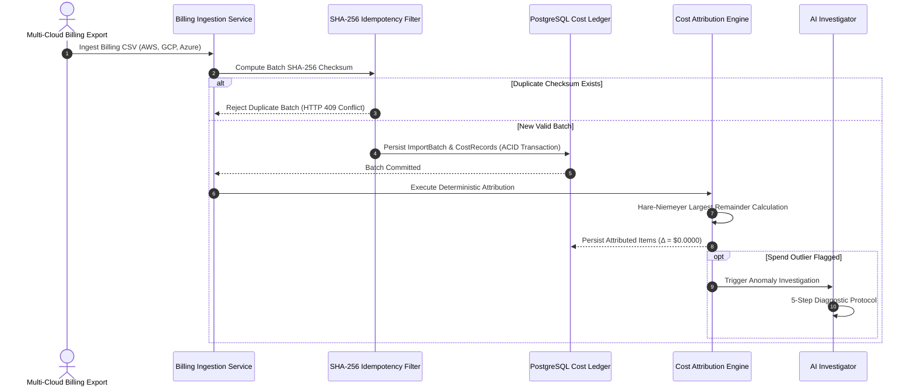
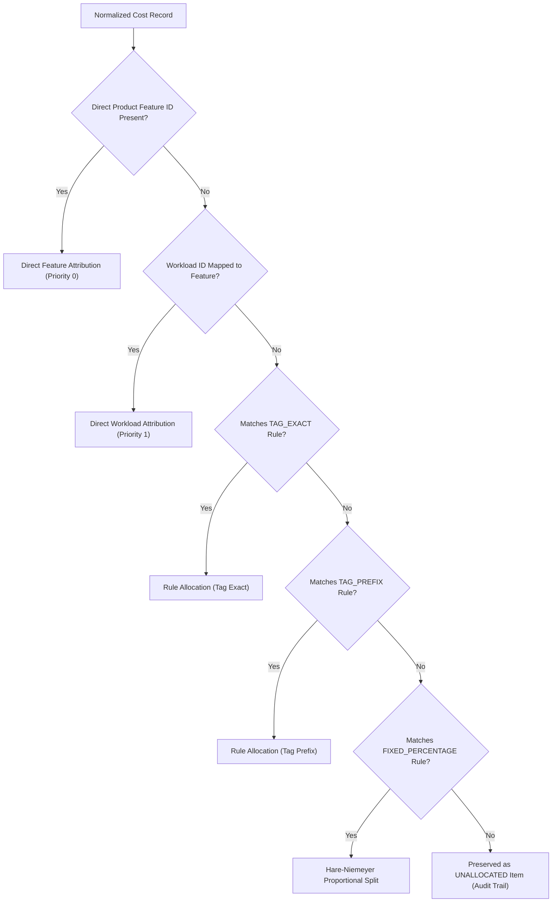
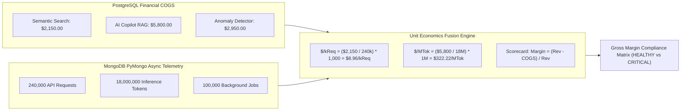
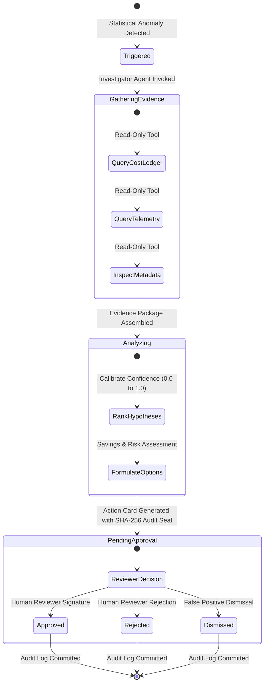

# MarginOps: High-Level Design (HLD)

---

## 1. System Architecture Overview

MarginOps is architected as an **enterprise modular monolith** with polyglot persistence, asynchronous background task processing, and a high-density single-page web application.

---

## 2. Technology Stack & Architectural Decision Records (ADRs)

| Component | Technology | Rationale & Architectural Trade-Off |
| :--- | :--- | :--- |
| **Backend Framework** | **FastAPI (Python 3.13)** | High-concurrency ASGI framework with native Pydantic v2 validation, automatic OpenAPI generation, and asynchronous I/O support. |
| **Architecture Pattern** | **Modular Monolith** | Avoids distributed microservice network overhead and eventual consistency issues; provides ACID transactions for ledger reconciliation while maintaining clean domain boundaries (`app/services/*`). |
| **Relational Storage** | **PostgreSQL 16** | ACID-compliant storage for financial records, multi-tenant lineage, allocation rules, and budgets. Enforces composite foreign keys `(organization_id, id)` for strict multi-tenancy. Accessed via SQLAlchemy 2.x asyncpg. |
| **Telemetry Storage** | **MongoDB 7.0** | Document store optimized for high-write, semi-structured telemetry logs and AI token metrics. Accessed via the **official PyMongo Async API** (`AsyncMongoClient`) with compound time-series indexes. |
| **Cache & Task Broker** | **Redis 7.2** | Sub-millisecond query caching, rate-limiting, and Celery asynchronous task broker. |
| **Frontend Framework** | **React 19 + TypeScript + Vite** | High-density enterprise SaaS interface built with strict static typing, client-side caching (TanStack Query v5), and component routing. |
| **CSS Framework** | **Tailwind CSS 4** | High-density styling via `@tailwindcss/vite` without PostCSS pipeline overhead, enforcing a sleek Linear/Datadog dark theme design system. |

---

## 3. Data Flow & Ingestion Pipeline Architecture

### 3.1. Ingestion Normalization
The ingestion pipeline processes multi-cloud line items from AWS Cost & Usage Reports (CUR), GCP Cloud Billing, and Azure Cost Management into a single canonical data structure (`ParsedBillingRecord`):
- Canonical provider normalization: `"Amazon Web Services"` $\rightarrow$ `"AWS"`, `"Google Cloud"` $\rightarrow$ `"GCP"`, `"Microsoft Azure"` $\rightarrow$ `"Azure"`.
- Monetary values stored strictly as exact 4-decimal `Decimal` instances (`Numeric(18, 4)`).
- Symmetrical handling of credits, rebates, and SLA discounts as negative billing amounts.

---

## 4. Deterministic Cost Attribution Engine Architecture

### 4.1. The Mathematical Invariant
To satisfy strict accounting standards, the attribution engine guarantees the **Conservation of Money**:
$$\sum_{r \in \text{Records}} \text{SourceAmount}(r) = \sum_{a \in \text{Allocated}} \text{Amount}(a) + \sum_{u \in \text{Unallocated}} \text{Amount}(u)$$
$$\Delta = \text{Total Source} - (\text{Total Allocated} + \text{Total Unallocated}) = \$0.0000$$

### 4.2. Hare-Niemeyer (Largest Remainder) Penny Distribution
When shared infrastructure costs (e.g. Kubernetes cluster nodes or staging databases) are divided between multiple features or cost centers, fractional cents cannot be rounded independently without creating cash leakage.
MarginOps implements the **Hare-Niemeyer method**:
1. Compute exact theoretical shares: $s_i = \frac{A \cdot w_i}{\sum w}$.
2. Floor all shares to precision quantum: $b_i = \lfloor s_i \rfloor$.
3. Compute the unrounded remainder: $R = A - \sum b_i$.
4. Sort targets by remainder fraction $r_i = s_i - b_i$ in descending order.
5. Distribute one quantum ($0.0001$) to the largest remainders until $R = 0$.
6. Symmetrically supports negative credits and refunds without sign inversion errors.

### 4.3. Multi-Tier Waterfall Pipeline

---

## 5. Unit Economics & Telemetry Fusion Engine Architecture

The Unit Economics Engine fuses financial infrastructure COGS (from PostgreSQL) with operational telemetry streams (from MongoDB):

---

## 6. Spend Forecasting Engine Architecture (Holt's Linear Trend)

The forecasting engine utilizes **Holt's Double Exponential Smoothing** on historical daily spend series:
1. **Level Equation**:
   $$\ell_t = \alpha Y_t + (1 - \alpha)(\ell_{t-1} + b_{t-1})$$
2. **Trend Equation**:
   $$b_t = \beta (\ell_t - \ell_{t-1}) + (1 - \beta)b_{t-1}$$
3. **Forecast Horizon ($h$ days ahead)**:
   $$\hat{Y}_{t+h} = \ell_t + h b_t$$
4. **Confidence Bounds (80% and 95%)**:
   $$\text{Lower / Upper Bound} = \hat{Y}_{t+h} \pm z \cdot \hat{\sigma} \sqrt{1 + (h-1)\alpha^2}$$

---

## 7. Evidence-Led AI Investigator & Governed Gate Architecture (Slide 06)

### Safety Invariants:
1. **Bounded Read-Only Tools**: The AI Agent only possesses query tools (`query_cost_ledger`, `query_telemetry`, `inspect_metadata`).
2. **Zero Direct Mutation**: The Agent cannot terminate instances, update configurations, or modify cloud provider resources.
3. **Cryptographic SHA-256 Audit Hash**: Every action card contains an immutable audit hash sealing the evidence and decision.

---

## 8. Deployment & Infrastructure Topology

The platform deploys via `docker-compose.yml` orchestrating isolated containers on an internal network (`marginops-network`):

| Container | Image | Ports | Role |
| :--- | :--- | :--- | :--- |
| `marginops-postgres` | `postgres:16-alpine` | `5432:5432` | Relational domain database with health check |
| `marginops-mongo` | `mongo:7.0` | `27017:27017` | Telemetry document database |
| `marginops-redis` | `redis:7.2-alpine` | `6379:6379` | Cache & Celery broker |
| `marginops-backend` | Python 3.13 ASGI | `8000:8000` | FastAPI modular monolith |
| `marginops-frontend`| React 19 + Vite | `5173:5173` | Production web application |
